<!--
  MOMINAAAH / DIGITAL LAB
  Replace or remove any detail that no longer reflects your current work.
-->

<p align="center">
  
</p>

<p align="right">
  <sub><code>INDEPENDENTLY CURIOUS · BUILDING IN PUBLIC</code></sub>
</p>

# Momina Ramzan <sup><sub>· Mominaaah</sub></sup>

I’m a Computer Science graduate interested in building practical software and understanding how intelligent systems behave beyond a demo.

My work currently moves between **AI and speech technology** and **data engineering** — from experimenting with voice-cloning workflows to turning public development indicators into structured datasets.

<p>
  <a href="https://github.com/Mominaaah"></a>
  
  
</p>

---

## `01 / FIELD NOTES`

- **I build:** small, end-to-end projects that connect a clear problem to a working pipeline.
- **I’m exploring:** speech technology, AI-generated audio detection, data pipelines, and reliable evaluation.
- **I value:** honest experiments, readable code, useful documentation, and making limitations visible.
- **Current direction:** strengthen my engineering foundations while exploring research questions around AI and speech.

## `02 / SELECTED BUILDS`

<table>
  <tr>
    <td width="50%" valign="top">
      <h3>◉ Vocalynx AI</h3>
      <p><code>SPEECH · AI · PROTOTYPE</code></p>
      An AI-focused final-year project exploring voice cloning and a multilingual speech workflow. The prototype connects teacher-recorded or uploaded audio with Urdu speech recognition, English translation, and voice synthesis experiments.
      <p><strong>Working with:</strong><br>Python · Whisper · TTS · Translation tooling</p>
      <p><a href="https://github.com/Mominaaah/Vocalynx-AI-FYP">Explore the repository ↗</a></p>
    </td>
    <td width="50%" valign="top">
      <h3>▤ Global Development Data Observatory</h3>
      <p><code>DATA ENGINEERING · ETL</code></p>
      A data pipeline project using the World Bank API to collect development indicators across 15 countries, transform them into CSV/JSON outputs, and validate the resulting dataset.
      <p><strong>Pipeline:</strong><br>API ingestion · Python · Data validation · CSV/JSON</p>
      <p><em>Project work in progress; a public repository link can be added here when published.</em></p>
    </td>
  </tr>
</table>

## `03 / TOOLKIT`

<p>
  
  
  
  
  
  
  
  
</p>

<sub>Tools shown reflect technologies I’ve worked with across projects and learning. Not every tool is used in every project.</sub>

## `04 / HOW I LIKE TO WORK`

```text
QUESTION  →  BUILD A SMALL EXPERIMENT  →  TEST THE ASSUMPTIONS
    ↑                                              ↓
    └──────────── DOCUMENT WHAT I LEARNED ←────────┘
```

I’m more interested in understanding why a system works — and where it fails — than in making a project look finished before it is.

## `05 / FIND ME`

- GitHub: [@Mominaaah](https://github.com/Mominaaah)
- Projects: [Vocalynx AI FYP](https://github.com/Mominaaah/Vocalynx-AI-FYP)

---

<p align="center">
  <sub><code>DESIGNED TO STAY CURIOUS.</code> &nbsp; <span>⌁</span> &nbsp; <code>BUILT ONE ITERATION AT A TIME.</code></sub>
</p>
